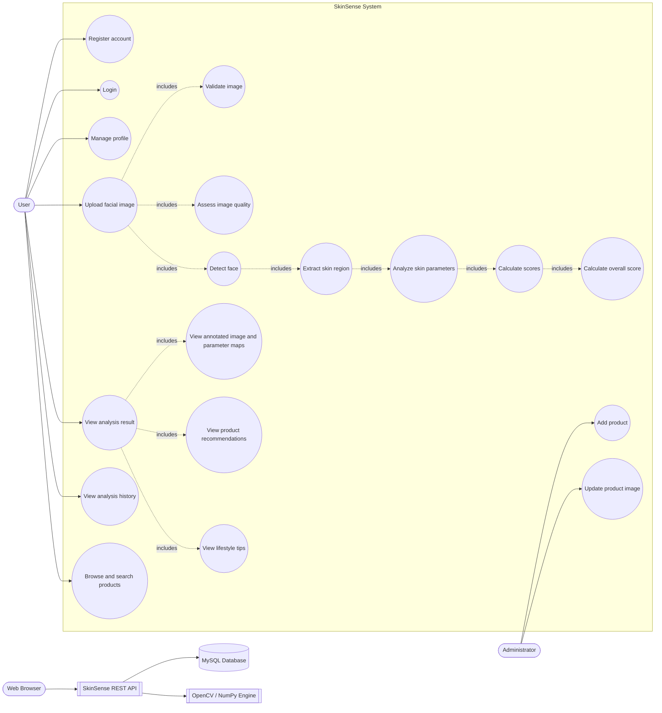
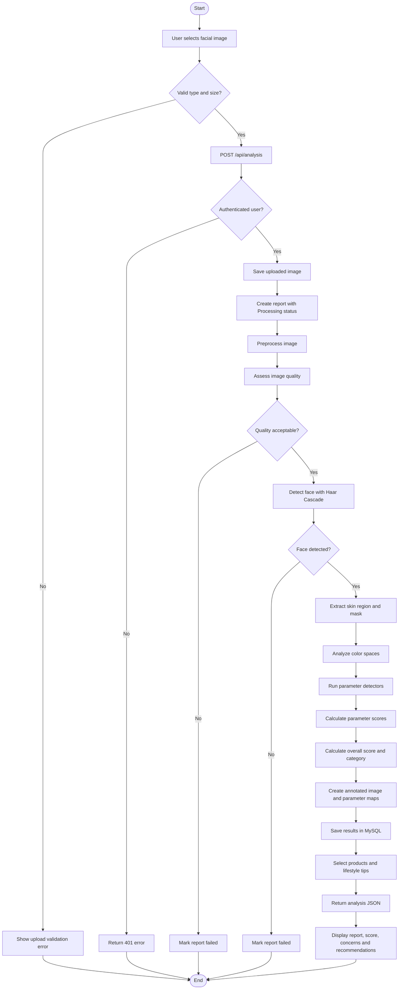
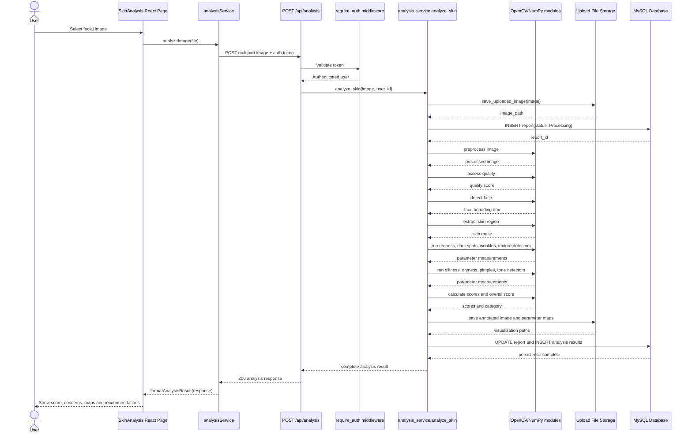
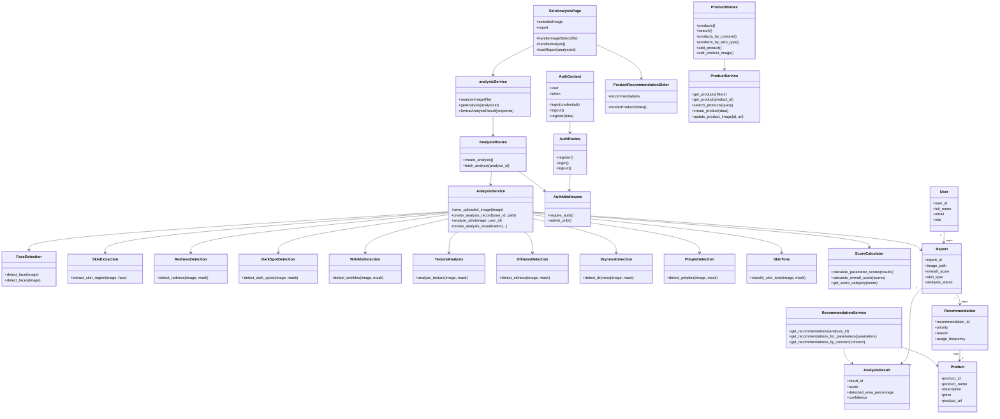
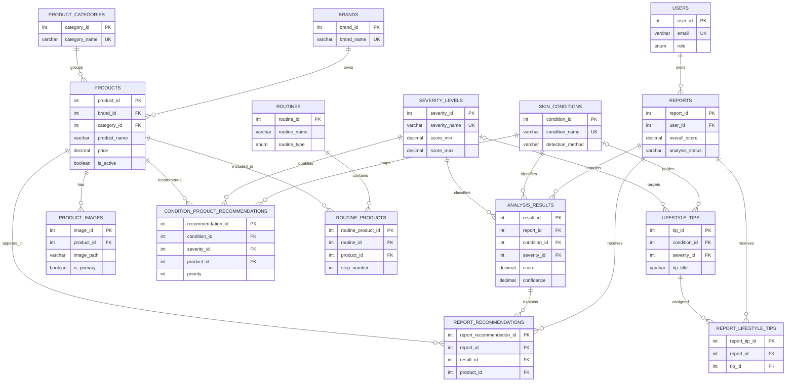
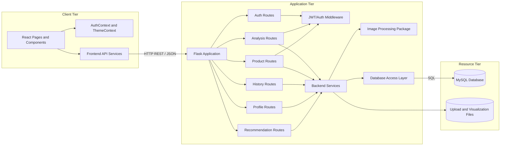
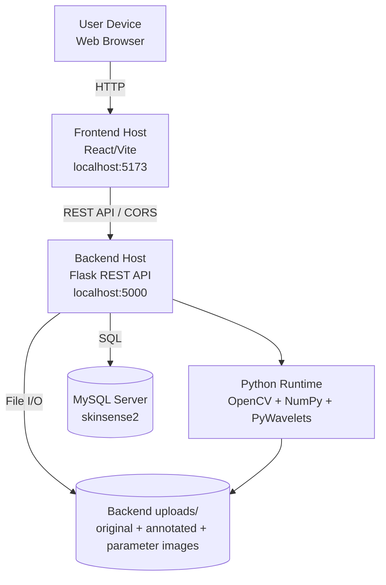
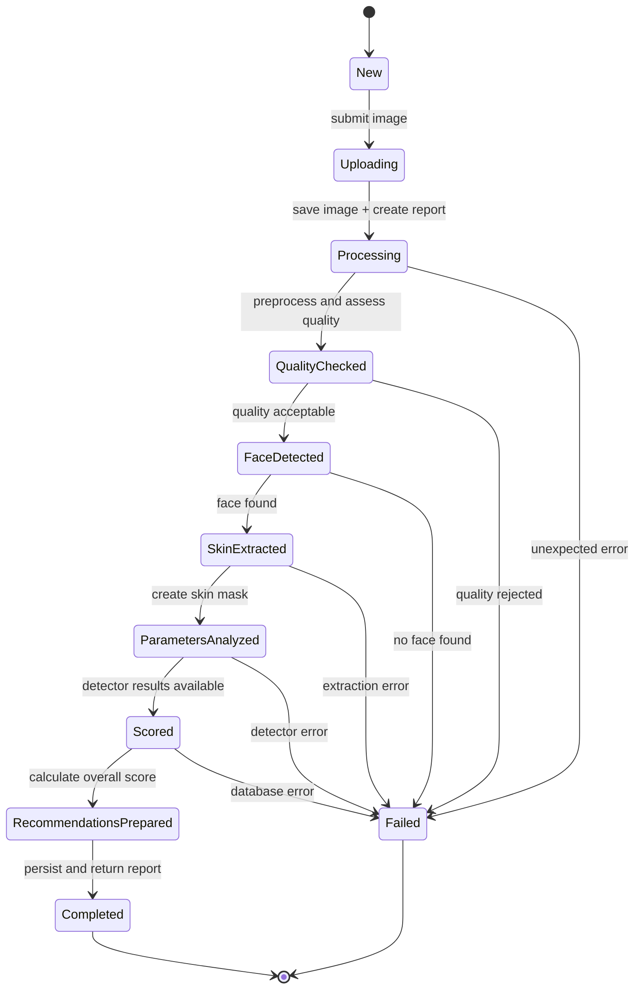

# SkinSense UML Diagram Guide

This document is a complete drawing reference for the SkinSense Digital Skin Analysis project. It is written from the implemented project structure:

- Frontend: React/Vite application in `frontend/`
- Backend: Flask REST API in `backend/`
- Image processing: OpenCV and NumPy modules in `backend/image_processing/`
- Database: MySQL schema in `backend/database/schema_normalized.sql`
- Product assets: local fallback assets in `frontend/public/products/`

Use the diagrams below for the project report, presentation, or software-design documentation. The Mermaid definitions can be pasted into Mermaid Live Editor, GitHub Markdown, or a Mermaid-compatible diagram tool. If drawing manually in draw.io, use the element lists and relationships given before each diagram.

## 1. System Scope

SkinSense accepts a facial image, validates and preprocesses it, detects the face and skin region, evaluates visible skin parameters, calculates scores, stores the report, and presents recommendations, products, tips, and history.

The system is an image-based preliminary assessment tool. It is not a medical diagnostic system.

## 2. Actors

### Primary actors

- **User**: registers, logs in, uploads a facial image, views results, views history, receives product suggestions, and manages profile information.
- **Administrator**: manages products and product advertisement images.

### External systems and supporting actors

- **Web Browser**: runs the React frontend and sends HTTP requests.
- **Flask REST API**: receives frontend requests and coordinates backend services.
- **MySQL Database**: stores users, reports, analysis results, products, recommendations, routines, and lifestyle tips.
- **OpenCV/NumPy Processing Engine**: detects the face and calculates image-based parameters.
- **File Storage**: stores uploaded images, annotated images, and parameter visualizations.

## 3. Diagram Set

Draw these diagrams in this order:

1. Use Case Diagram: system functionality and actors.
2. Activity Diagram: complete facial-analysis workflow.
3. Sequence Diagram: upload-to-result interaction.
4. Class Diagram: major software classes/modules and their relationships.
5. ER Diagram: database tables and foreign-key relationships.
6. Component Diagram: frontend, backend, processing, database, and storage boundaries.
7. Deployment Diagram: physical/runtime deployment.
8. State Diagram: analysis report lifecycle.

---

# Diagram 1: Use Case Diagram

## Purpose

Shows what each actor can do from outside the system.

## Actors to draw

- User
- Administrator
- Web Browser
- MySQL Database
- Image Processing Engine

## Use cases to draw

### Authentication

- Register account
- Login
- Logout
- Manage profile

### Analysis

- Upload facial image
- Validate image
- Assess image quality
- Detect face
- Extract skin region
- Analyze skin parameters
- Calculate parameter scores
- Calculate overall skin health score
- View analysis result
- View annotated image and parameter maps

### Recommendations and history

- View product recommendations
- View lifestyle tips
- View analysis history
- View previous report
- Browse products
- Search products
- Filter products by category, concern, or skin type

### Administration

- Add product
- Update product image
- Manage product information

## Relationships to draw

- `Upload facial image` includes `Validate image`.
- `Upload facial image` includes `Assess image quality`.
- `Upload facial image` includes `Detect face`.
- `Detect face` includes `Extract skin region`.
- `Extract skin region` includes `Analyze skin parameters`.
- `Analyze skin parameters` includes `Calculate parameter scores`.
- `Calculate parameter scores` includes `Calculate overall skin health score`.
- `View analysis result` includes `View annotated image and parameter maps`.
- `View analysis result` includes `View product recommendations`.
- `View analysis result` includes `View lifestyle tips`.
- Administrator specializes the User actor for product-management use cases.

## Mermaid version

---

# Diagram 2: Activity Diagram

## Purpose

Shows the control flow from image upload to the final score and recommendations.

## Activity steps

1. User selects an image.
2. Frontend validates file type and size.
3. Backend authenticates the user.
4. Backend validates the uploaded extension.
5. Backend saves the image with a generated filename.
6. Backend creates a report with `Processing` status.
7. Image is preprocessed.
8. Image quality is assessed.
9. If quality is insufficient, the report fails and an error is returned.
10. Face is detected using Haar Cascade.
11. If no face is found, the report fails.
12. Facial skin region is extracted.
13. Color analysis is performed.
14. Redness, dark spots, wrinkles, texture, oiliness, dryness, pimples, and skin tone are analyzed.
15. Parameter scores are calculated.
16. Overall score and category are calculated.
17. Annotated images and parameter visualizations are saved.
18. Results are persisted in the database.
19. Product recommendations and lifestyle tips are selected.
20. Report is returned to the frontend.
21. User views the result.

## Mermaid version

---

# Diagram 3: Sequence Diagram

## Purpose

Shows the message order for the main use case: uploading an image and receiving an analysis report.

## Lifelines

- User
- React `SkinAnalysis` page
- `analysisService`
- Flask `analysis_routes`
- `auth` middleware
- `analysis_service`
- Image-processing modules
- MySQL database
- Upload/file storage

## Important messages

- `POST /api/analysis` with multipart image and authenticated token.
- `require_auth()` validates the token and sets the authenticated user.
- `save_uploaded_image()` stores the source image.
- `create_analysis_record()` inserts the initial report.
- Processing modules return measurements and masks.
- Score calculator returns parameter scores and overall score.
- Visualizer writes annotated images.
- Database stores the completed report and result rows.
- API returns the formatted analysis response.

## Mermaid version

---

# Diagram 4: Class Diagram

## Purpose

Shows the main software abstractions and how they collaborate. Since the backend is Python and the frontend is React, represent React pages/services as classes or components with stereotypes.

## Classes/components to draw

### Frontend

- `SkinAnalysisPage`
- `AuthContext`
- `analysisService`
- `productService`
- `ProductRecommendationSlider`
- `SkinParameters`

### Backend API

- `AuthRoutes`
- `AnalysisRoutes`
- `ProductRoutes`
- `HistoryRoutes`
- `ProfileRoutes`
- `RecommendationRoutes`
- `AuthMiddleware`

### Backend services

- `AuthService`
- `AnalysisService`
- `ProductService`
- `HistoryService`
- `ProfileService`
- `RecommendationService`

### Image-processing functions/modules

- `Preprocessing`
- `ImageQuality`
- `FaceDetection`
- `SkinExtraction`
- `ColorAnalysis`
- `RednessDetection`
- `DarkSpotDetection`
- `WrinkleDetection`
- `TextureAnalysis`
- `OilinessDetection`
- `DrynessDetection`
- `PimpleDetection`
- `SkinTone`
- `ScoreCalculator`

### Data objects

- `User`
- `Report`
- `AnalysisResult`
- `Product`
- `Recommendation`
- `LifestyleTip`

## Relationships to draw

- Routes depend on their corresponding services.
- `AnalysisService` composes the image-processing modules.
- `AnalysisService` uses `Database` and `FileStorage`.
- `SkinAnalysisPage` uses `analysisService`, `SkinParameters`, and `ProductRecommendationSlider`.
- `RecommendationService` uses `AnalysisResult`, `Product`, and severity rules.
- `Report` has many `AnalysisResult` objects.
- `AnalysisResult` refers to one `SkinCondition` and one `SeverityLevel`.
- `Product` belongs to a `Brand` and `ProductCategory`.

## Mermaid version

---

# Diagram 5: ER / Database Diagram

## Purpose

Shows the permanent data model and foreign-key relationships. Use crow's-foot notation when drawing manually.

## Tables and important attributes

### User and analysis

- `users(user_id PK, full_name, email, phone_no, password, profile_image, role, created_at, updated_at)`
- `reports(report_id PK, user_id FK, image_path, analysis_date, overall_score, overall_status, skin_type, image_quality_score, analysis_status, error_message)`
- `skin_conditions(condition_id PK, condition_name, description, detection_method)`
- `severity_levels(severity_id PK, severity_name, score_min, score_max, description)`
- `analysis_results(result_id PK, report_id FK, condition_id FK, severity_id FK, score, detected_area_percentage, confidence, detected_regions)`

### Products

- `brands(brand_id PK, brand_name, description, brand_logo, website_url)`
- `product_categories(category_id PK, category_name, description)`
- `products(product_id PK, brand_id FK, category_id FK, product_name, description, ingredients, usage_instructions, skin_type, price, product_url, is_active)`
- `product_images(image_id PK, product_id FK, image_path, image_type, is_primary)`

### Recommendations and guidance

- `condition_product_recommendations(recommendation_id PK, condition_id FK, severity_id FK, product_id FK, priority, recommendation_reason, usage_frequency)`
- `report_recommendations(report_recommendation_id PK, report_id FK, result_id FK, product_id FK, priority, reason)`
- `routines(routine_id PK, routine_name, routine_type, description)`
- `routine_products(routine_product_id PK, routine_id FK, product_id FK, step_number, instruction)`
- `lifestyle_tips(tip_id PK, tip_title, tip_description, condition_id FK, severity_id FK)`
- `report_lifestyle_tips(report_tip_id PK, report_id FK, tip_id FK)`

## Cardinalities

- One `users` row has many `reports` rows.
- One `reports` row has many `analysis_results` rows.
- One `skin_conditions` row has many `analysis_results` rows.
- One `severity_levels` row has many `analysis_results` rows.
- One `brands` row has many `products` rows.
- One `product_categories` row has many `products` rows.
- One `products` row has many `product_images` rows.
- `condition_product_recommendations` resolves the many-to-many relationship between conditions and products with severity and priority.
- `report_recommendations` links a report and analysis result to a recommended product.
- `routines` and `products` are many-to-many through `routine_products`.
- `reports` and `lifestyle_tips` are many-to-many through `report_lifestyle_tips`.

## Mermaid version

---

# Diagram 6: Component Diagram

## Purpose

Shows the deployable software parts and their interfaces.

## Components to draw

### Frontend components

- React UI pages: Home, Login, Signup, Dashboard, SkinAnalysis, History, Products, Profile.
- React contexts: `AuthContext`, `ThemeContext`.
- Frontend services: `api`, `authService`, `analysisService`, `productService`, `historyService`, `profileService`.
- Shared components: `SkinParameters`, charts, product sliders, upload components.

### Backend components

- Flask application.
- Authentication routes and services.
- Analysis routes and service.
- Product routes and service.
- Recommendation routes and service.
- History routes and service.
- Profile routes and service.
- Authentication middleware.
- Image-processing package.
- Database access layer.
- Upload and visualization storage.

## Interfaces

- REST/JSON over HTTP between React and Flask.
- Multipart upload for facial images.
- SQL between services/database access and MySQL.
- Local file I/O between analysis service and upload storage.

## Mermaid version

---

# Diagram 7: Deployment Diagram

## Purpose

Shows where each part runs at runtime.

## Nodes to draw

- User device/browser.
- Frontend development/production server, typically Vite during development.
- Backend server running Flask on port 5000.
- MySQL database server.
- File system or upload directory.

## Artifacts

- React JavaScript/CSS bundle.
- Flask Python application.
- OpenCV Haar Cascade XML file.
- Python image-processing modules.
- MySQL schema and data.
- Uploaded original and generated analysis images.

## Mermaid version

## Deployment notes

- Frontend API base URL is configured with `VITE_API_URL`, defaulting to `http://localhost:5000/api`.
- Flask enables CORS for `/api/*`.
- Backend limits uploaded files to 5 MB.
- Uploaded files are generated with UUID-based filenames.

---

# Diagram 8: Analysis Report State Diagram

## Purpose

Shows the lifecycle of an analysis report from upload through completion or failure.

## States

- New
- Uploading
- Processing
- Quality Checked
- Face Detected
- Skin Extracted
- Parameters Analyzed
- Scored
- Recommendations Prepared
- Completed
- Failed

## Transitions

- New -> Uploading: user submits an image.
- Uploading -> Processing: image saved and report created.
- Processing -> Quality Checked: preprocessing and quality assessment finish.
- Quality Checked -> Face Detected: quality is acceptable.
- Quality Checked -> Failed: quality is unacceptable.
- Face Detected -> Skin Extracted: face found.
- Face Detected -> Failed: no face found.
- Skin Extracted -> Parameters Analyzed: mask is created.
- Parameters Analyzed -> Scored: all detectors return measurements.
- Scored -> Recommendations Prepared: score and category are available.
- Recommendations Prepared -> Completed: results are stored and returned.
- Any processing state -> Failed: unexpected processing/database error.

## Mermaid version

---

# 4-Stage Presentation Version

For a short project presentation, group the complete system into these four modules, matching the Home page:

1. **Upload Image Module**: accepts and validates the facial image.
2. **Image Processing Module**: preprocesses the image, checks quality, detects the face, and extracts the skin region.
3. **Parameter Analysis Module**: detects redness, dark spots, wrinkles, texture, oiliness, dryness, pimples, and skin tone, then calculates scores.
4. **Results Module**: displays the overall score, concerns, annotated images, product suggestions, lifestyle tips, and analysis history.

Draw these four modules as a high-level package diagram if your report requires one:

# Drawing Conventions

Use these UML conventions when reproducing the diagrams manually:

- **Actor**: stick figure.
- **Use case**: oval.
- **Class/component**: rectangle with a name compartment.
- **Database table/entity**: rectangle with attributes or crow's-foot ER notation.
- **System boundary**: large rectangle around use cases.
- **Solid arrow**: request, dependency, or control flow.
- **Dashed arrow**: include, return, or indirect dependency.
- **Open triangle arrow**: inheritance/generalization.
- **Filled diamond**: composition; use only when the child cannot exist independently.
- **Open diamond**: aggregation.
- **Crow's foot**: many relationship.
- **1**: exactly one.
- **0..1**: optional one.
- **0..***: zero or many.
- **1..***: one or many.

# Recommended Report Order

1. System overview.
2. Use case diagram.
3. Four-module architecture diagram.
4. Activity diagram.
5. Sequence diagram.
6. Class diagram.
7. ER/database diagram.
8. Component diagram.
9. Deployment diagram.
10. State diagram.
11. Short explanation of the image-processing algorithms.
12. Limitations: image quality, lighting, pose, skin-tone variation, and non-medical preliminary assessment.

# Algorithm Reference for the Diagrams

- Face detection: OpenCV Haar Cascade frontal-face classifier.
- Redness: LAB, HSV, and excess-red voting with morphology and connected components.
- Dark spots: grayscale, LAB, YCrCb, black-hat morphology, and connected components.
- Wrinkles: CLAHE, black-hat morphology, Gabor filters, Canny, Laplacian, and LBP.
- Texture: LBP variance, Gabor filters, Laplacian, Haar wavelets, and GLCM contrast.
- Oiliness: HSV brightness, low saturation, LAB brightness, and connected components.
- Dryness: grayscale mean brightness and standard deviation.
- Pimples: HSV/LAB redness, adaptive thresholding, morphology, and connected components.
- Skin tone: median LAB lightness; tone uniformity uses lightness standard deviation.
- Overall score: parameter scores are combined by the score-calculation module and mapped to a score category.
